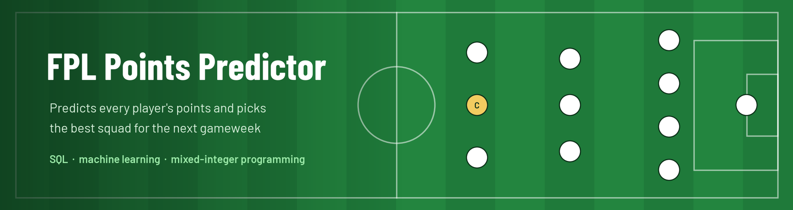
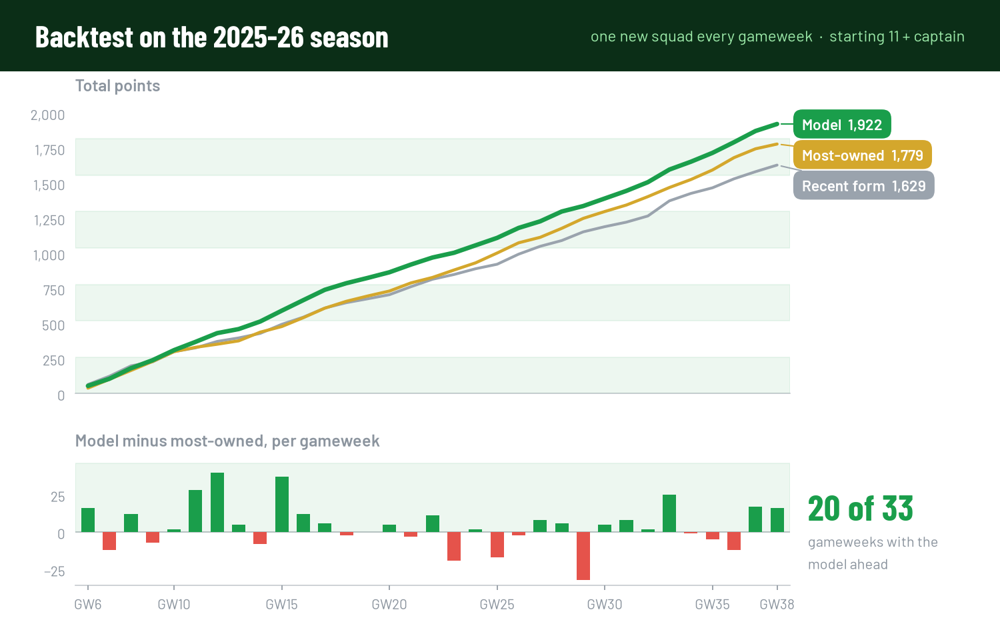
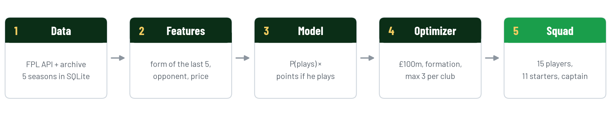
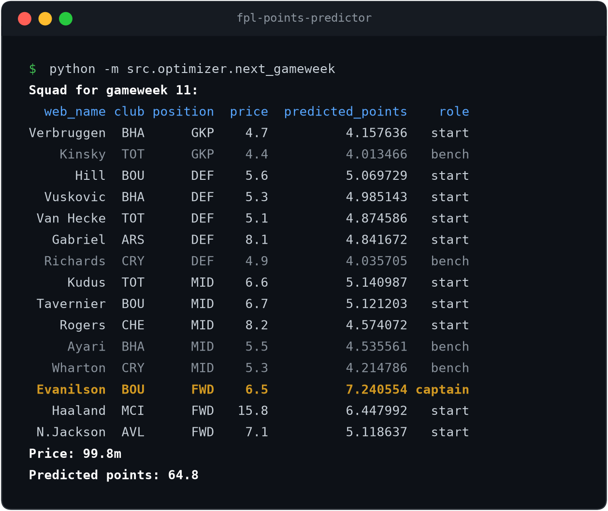

<p align="center">
  
</p>

<p align="center">
  
  
  
  
  
</p>

## Table of Contents

- [Overview](#overview)
- [Results](#results)
- [How it works](#how-it-works)
- [Example squad](#example-squad)
- [Quick start](#quick-start)
- [Roadmap](#roadmap)

## Overview

**The problem.** Every gameweek, a Fantasy Premier League (FPL) manager picks 15 players under a £100m budget, with rules on positions, clubs and formation. Which players will score the most points?

**The approach.** A machine learning model predicts the points of every player from his recent form, the opponent and his price. A mixed-integer program then picks the squad, the starting 11 and the captain with the most predicted points under the FPL rules.

**The result.** In a backtest on the 2025-26 season, squads picked with the model scored 18% more points than squads picked by recent form, and 8% more than squads of the most-owned players (a smaller, .

<p align="center">
  
</p>

## Results

All numbers are for the 2025-26 season, and every prediction uses only matches played before it.

| Squad picked by | Points per gameweek | Share of the perfect squad | Model ahead in |
|---|---|---|---|
| **Model** | **58.2** | **38%** | – |
| Most-owned players | 53.9 | 35% | 20 of 33 gameweeks |
| Recent form | 49.4 | 32% | 23 of 33 gameweeks |
| Perfect (hindsight) | 155.1 | 100% | – |

- **Better predictions:** the model cuts the prediction error by 7% compared with recent form (RMSE 1.955 vs 2.108).
- **Clear gain over recent form:** +8.9 points per gameweek, with a rough 95% range of +4.1 to +13.7.
- **Smaller edge over the most-owned players:** +4.3 points per gameweek (range −0.9 to +9.5), too close to call after one season. Managers react to injury news, and the backtest has none, because the data has no record of past injuries.

All models, the MAE, the error per block of gameweeks, the bench weight and the limits of the backtest are in [docs/results.md](docs/results.md).

## How it works

<p align="center">
  
</p>

1. **Data.** Players, teams, fixtures and matches of the current season from the official FPL API, and four past seasons from vaastav's public archive of that API, [Fantasy-Premier-League](https://github.com/vaastav/Fantasy-Premier-League). Everything goes into one SQLite database, with a season column in every table, so all seasons are queried the same way.
2. **Features.** Average points, minutes and starts over the previous 5 matches of the same season, position, home or away, opponent strength and price: only what is known before kickoff.
3. **Model.** Most player-matches end with 0 points because the player does not play. So the model has two parts, both gradient-boosted trees: the probability that the player plays, and his expected points if he plays. The prediction is their product. Before each gameweek, the model is trained again on all finished matches.
4. **Optimizer.** Taking the 15 highest predictions would break the budget, the positions and the club limit. A mixed-integer program (PuLP with the HiGHS solver) finds the best squad that respects all FPL rules, and chooses the starting 11 and the captain at the same time, because the captain's double points can change who is worth buying.
5. **Squad.** The result is 15 players, the starting 11 and a captain for the next gameweek. The unplayed matches get their features with the same code as the finished ones, and players who are injured or suspended are left out.

<details>
<summary>The optimization model</summary>

For every player $i$ with predicted points $p_i$ and price $v_i$ (in £m), three yes/no decisions: $x_i$ (in the squad), $s_i$ (starts) and $c_i$ (captain).

$$
\max \sum_i p_i \left( s_i + 0.1\,(x_i - s_i) + c_i \right)
$$

subject to

$$
\begin{aligned}
&\textstyle\sum_i x_i = 15, \quad \sum_i v_i x_i \le 100 && \text{squad size and budget} \\
&\textstyle\sum_{i \in P} x_i = n_P \quad \text{for each position } P \;(n = 2, 5, 5, 3) && \text{players per position} \\
&\textstyle\sum_{i \in C} x_i \le 3 \quad \text{for each club } C && \text{at most 3 per club} \\
&s_i \le x_i, \quad \textstyle\sum_i s_i = 11, \quad l_P \le \sum_{i \in P} s_i \le u_P && \text{starting 11 and formation} \\
&\textstyle\sum_{i \in P} x_i = n_P \quad \text{for each position } P && \text{players per position} \\
&\textstyle\sum_{i \in C} x_i \le 3 \quad \text{for each club } C && \text{at most 3 per club} \\
&s_i \le x_i, \quad \textstyle\sum_i s_i = 11 && \text{starting 11} \\
&l_P \le \textstyle\sum_{i \in P} s_i \le u_P \quad \text{for each position } P \;(l = 1, 3, 2, 1;\ u = 1, 5, 5, 3) && \text{valid formation} \\
&c_i \le s_i, \quad \textstyle\sum_i c_i = 1 && \text{one captain among the starters} \\
&x_i, s_i, c_i \in \{0, 1\}
\end{aligned}
$$

A starter counts fully, a bench player with weight 0.1 (he may come on for a starter who does not play), and the captain once more, so his points count double.

</details>

### Design choices

- **Only information from before the match.** The form uses earlier matches only. Price, home or away and the opponent are known before kickoff.
- **Time-based split.** Train on earlier matches, test on later ones. A random split would let the model learn from the future.
- **One id per player across seasons.** FPL ids change every season, so players are matched by their `code`.
- **Opponent strength on one scale.** The archive and the current API rate teams differently, so each season is rescaled from 0 to 1.

## Example squad

The squad the model picked on 12 November 2026 for gameweek 11 of 2026-27. The 64.8 predicted points count the starting 11, with the captain's points doubled.

<p align="center">
  
</p>

## Quick start

Needs Python 3.14 (tested) and an internet connection for the FPL API.

**1. Install**

```bash
git clone https://github.com/ArvellLeoputra/fpl-points-predictor.git
cd fpl-points-predictor
python -m venv .venv
source .venv/bin/activate          # on Windows: .venv\Scripts\activate
pip install -r requirements.txt
```

**2. Build the database**

```bash
python -m src.database.download_history      # past seasons (only once)
python -m src.database.download_gameweeks    # current season
python -m src.database.build_db              # builds data/fpl.db
```

**3. Pick a squad for the next gameweek**

```bash
python -m src.optimizer.next_gameweek
```

After each gameweek, run step 2 (without the first line) and step 3 again. The database and the raw data are not stored in this repository.

<details>
<summary>All commands</summary>

```bash
# SQL queries on the database (needs the sqlite3 command-line tool)
sqlite3 data/fpl.db < sql/value_for_money.sql             # points per million
sqlite3 data/fpl.db < sql/rolling_form.sql                # average of the last 5 matches
sqlite3 data/fpl.db < sql/baseline.sql                    # error of the baseline

# Experiments
python -m src.modeling.experiments.compare_models         # linear regression and trees against the baseline
python -m src.modeling.experiments.minutes_model          # does the player play?
python -m src.modeling.experiments.two_part_model         # two-part model against one model
python -m src.modeling.experiments.error_by_round         # error per block of gameweeks
python -m src.modeling.experiments.weekly_training        # train once against train every gameweek

# Predictions and squads
python -m src.modeling.predictions                        # predicted points of one gameweek (top 10)
python -m src.optimizer.squad                             # best squad for one gameweek
python -m src.optimizer.backtest                          # squads for a whole season

# Pictures of this README
python -m src.plots.backtest_chart                        # backtest chart
python -m src.plots.banner                                # banner
python -m src.plots.pipeline                              # steps picture
python -m src.plots.terminal                              # example squad
```

</details>

## Roadmap

- Transfers between gameweeks (1 free transfer per gameweek, −4 points for each extra one) and automatic substitutions
- Save the injury news every week, so later backtests can use it
- Track the real points of each predicted squad during the season
- Backtest from gameweek 2, with a way to handle the thin form in the first weeks
- Weekly refresh with GitHub Actions
- More seasons and model tuning

<p align="right"><a href="#top">Back to top</a></p>
